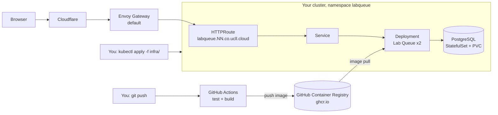

# Assignment: from source code to a URL

In this assignment you take an existing application, **Lab Queue**, and bring it all the way to production on your own Kubernetes cluster:

1. **Containerise it** with a Dockerfile.
2. **Automate the build** with GitHub Actions, so every commit on `main` produces a tested, tagged image in a registry.
3. **Run it on Kubernetes**, together with its PostgreSQL database, and publish it at `http://labqueue.NN.co.ucll.cloud`.

The application itself is finished. You do not have to write or change any application code. Your work is the Dockerfile, the pipeline and the infrastructure around it.

Everywhere in this document, **NN** stands for your personal number (see *Your cluster: architecture and how to connect*).



Notice the split in the picture: **CI builds, you deploy.** The pipeline does not talk to your cluster. In lesson 3 we replace the manual `kubectl apply` with Argo CD, and the pipeline still does not need cluster access. Keep it that way from the start.

## What is in this repository

| Path | What it is |
| --- | --- |
| `src/`, `public/`, `test/` | The application. Do not change it. |
| `package.json`, `package-lock.json` | Dependencies, pinned. |
| [`docs/application.md`](docs/application.md) | **Read this first.** Environment variables, database, health endpoints, startup and shutdown behaviour. Everything you need to know to run the app. |
| [`infra/`](infra/README.md) | Empty, for you: your Kubernetes manifests and the documentation of how you deploy. |
| [`AGENTS.md`](AGENTS.md) | Instructions for AI coding assistants working in this repository. Read it too, so you know what your assistant is told. |
| `.env.example` | Template for running the app locally. |

What you add:

| Path | What |
| --- | --- |
| `Dockerfile` | How the image is built |
| `.dockerignore` | What stays out of the build context |
| `.github/workflows/` | Your GitHub Actions workflow(s) |
| `infra/` | Your Kubernetes manifests and `infra/README.md` |

## Before you start

- Your cluster works: `kubectl get nodes` shows one node that is `Ready`. If not, follow the *Install guide* and *Your cluster* pages first.
- Docker (Docker Desktop, OrbStack, Podman or similar) runs on your laptop.
- Optional, but useful: Node.js 24, so you can run the app without a container.
- This repository is pushed to GitHub, and you can see the **Actions** tab.

## Part 0: run the application locally

Before you package something, see it work. Follow *Running it on your laptop* in [`docs/application.md`](docs/application.md#running-it-on-your-laptop-without-building-an-image): start a PostgreSQL container, run `npm ci` and `npm run dev`, and open http://localhost:8080. Add a ticket, mark it as helped.

Then break it on purpose. Stop the database container and look at `http://localhost:8080/readyz` and `http://localhost:8080/healthz`. Start the app with `DB_PASSWORD` missing. Read the log lines. You will see these same messages again in `kubectl logs`, and it is easier to learn them here.

## Part 1: Dockerfile

Write a `Dockerfile` (and `.dockerignore`) in the root of the repository.

**Requirements**

- [ ] The base image is pinned to a specific version (no `latest`, no untagged image). Choose an image that matches the Node.js version in [`docs/application.md`](docs/application.md).
- [ ] Dependencies are installed with `npm ci`, from the lock file, without dev tooling in the final image.
- [ ] The layers are ordered so that a change in `src/` does **not** reinstall all dependencies. Prove it: change a line in `public/index.html`, rebuild, and show that the `npm ci` step comes from the cache.
- [ ] The container does **not** run as root.
- [ ] The app's process receives `SIGTERM`: `docker stop` returns in about a second, not after a 10-second timeout. (Why does this matter? See *Startup and shutdown behaviour* in the docs.)
- [ ] The version is baked in at build time: a build argument sets `APP_VERSION`, so the footer of the page shows which build is running.
- [ ] No secrets, no `.env` file and no `node_modules` from your laptop end up in the image. Check with `docker history` and by looking inside the image.
- [ ] The final image is under 250 MB. Report the size you reached.

**Check it works** with a database in a container. Both containers need to be in the same Docker network, and the app reaches the database by its container name:

```bash
docker network create labqueue
```

```bash
docker run -d --name labqueue-db --network labqueue -e POSTGRES_USER=labqueue -e POSTGRES_PASSWORD=changeme -e POSTGRES_DB=labqueue postgres:18
```

```bash
docker build --build-arg APP_VERSION=local -t labqueue:local .
```

```bash
docker run --rm --network labqueue -p 8080:8080 -e DB_HOST=labqueue-db -e DB_NAME=labqueue -e DB_USER=labqueue -e DB_PASSWORD=changeme labqueue:local
```

A Docker Compose file for this is allowed and handy, but it is not a requirement.

## Part 2: GitHub Actions

Create a workflow in `.github/workflows/` that builds and publishes your image to the **GitHub Container Registry** (`ghcr.io`).

**Requirements**

- [ ] On every **pull request**: install dependencies, run `npm test`, and build the image. Do not push it.
- [ ] On every **push to `main`**: the same, and push the image to `ghcr.io/<owner>/<repository>`.
- [ ] If the tests fail, no image is built or pushed.
- [ ] Every pushed image is tagged with the **Git commit SHA**. Nobody deploys `latest`. (You may push extra tags, such as `main`, as long as the SHA tag is there.)
- [ ] `APP_VERSION` in the image is that same SHA, so you can trace a running pod back to a commit.
- [ ] The workflow logs in to GHCR with the built-in `GITHUB_TOKEN`. No personal access tokens in the workflow.
- [ ] The workflow asks only for the permissions it needs (`permissions:` block).
- [ ] Every action you use (`uses:`) is pinned to a version. Bonus: pin to a full commit SHA and explain why that is safer.
- [ ] The workflow has **no access to your cluster**. No kubeconfig in GitHub secrets.

When it works, you see a green run in the **Actions** tab, and the image under **Packages** on your GitHub profile or organisation.

> **Watch out:** image names on GHCR must be lowercase. GitHub usernames and organisation names often contain capitals. `${{ github.repository }}` does not lowercase anything for you.

## Part 3: Kubernetes

Write the manifests to run Lab Queue and PostgreSQL on your cluster. Store them in `infra/` and document how to deploy them in [`infra/README.md`](infra/README.md).

**Requirements**

Overall:

- [ ] Everything runs in its own namespace, `labqueue`.
- [ ] Someone with your repository and an empty cluster can deploy everything by following `infra/README.md`. Test this: delete the namespace and deploy again from scratch.
- [ ] No plain-text passwords are committed to Git. Commit an example Secret with placeholders, and document the command that creates the real one. (We cover proper secret management in lesson 5.)
- [ ] Every container has resource requests and limits. Your node has 2 CPUs and 8 GB of memory, for everything.
- [ ] Every image is pinned to a specific tag.

PostgreSQL:

- [ ] Runs as a **StatefulSet** with one replica, with its data on a PersistentVolumeClaim (the cluster's default StorageClass is `local-path`).
- [ ] Data survives deleting the database pod.
- [ ] User, password and database name come from a Secret.
- [ ] Reachable inside the cluster through a Service. It is **not** exposed to the internet.
- [ ] Has a readiness probe (look at `pg_isready`).

Lab Queue:

- [ ] Runs as a **Deployment** with **2 replicas**, using the image that your pipeline built, referenced by its SHA tag.
- [ ] Gets its configuration from a ConfigMap and its password from the same Secret as the database. Check [`docs/application.md`](docs/application.md) for every variable.
- [ ] Has a liveness probe and a readiness probe, each on the right endpoint. Be ready to explain why it is not the same endpoint twice.
- [ ] Has a security context: not root, no privilege escalation, a read-only root file system, all capabilities dropped. The app is built to run this way.
- [ ] Is reachable inside the cluster through a Service on port 80.
- [ ] Is published at `http://labqueue.NN.co.ucll.cloud` with an **HTTPRoute** on the `default` Gateway in the `envoy-gateway-system` namespace. (There is an example on the *Your cluster* page.)

If your package on GHCR is private, the cluster cannot pull it and your pods end in `ImagePullBackOff`. Either make the package public (Package settings, *Change visibility*), or create an image pull secret. Document which one you chose and why.

**Validate before you apply**, as described in *Working with AI*:

```bash
kubectl apply -f infra/ --recursive --dry-run=server
```

## Part 4: prove it works

Show each of these, with the command and its output (a screenshot or a pasted terminal block in `infra/README.md` is fine):

1. `http://labqueue.NN.co.ucll.cloud` loads, and you can add and resolve a ticket.
2. The version in the page footer is the commit SHA of the latest green pipeline run on `main`.
3. Requests are spread over both replicas: call `/api/info` a few times and show two different hostnames.
4. Delete one app pod. The site keeps working, and a new pod replaces it.
5. Delete the PostgreSQL pod. When it is back, your tickets are still there.
6. **A full release:** change something visible (for example the subtitle in `public/index.html`), push it, let the pipeline build the new image, update the tag in your manifest, apply it, and watch the rollout with `kubectl rollout status`. Show the new SHA in the footer. Did the site go down during the rollout?
7. Scale the database to zero replicas. What happens to `/readyz`, to the pods' `READY` column and to the website? Scale it back up. Does the app recover without a restart?

## Working with AI

You are encouraged to use AI for this assignment, following the workflow from *Working with AI*: intent, generate, read, validate, apply, verify, explain back. This repository contains an [`AGENTS.md`](AGENTS.md) with the context an AI assistant needs (the cluster setup, the app's quirks, the rules of this course). Most coding assistants read it automatically.

Traffic lights for this assignment:

| | |
| --- | --- |
| Green | Dockerfile boilerplate, a first draft of a Deployment or Service, explaining an error message |
| Amber | The GitHub Actions workflow and its permissions, probes, resource requests and limits, the PostgreSQL StatefulSet and volume |
| Red | Secrets and how they get into the cluster, the registry token, anything exposed to the internet |

**Review the AI challenges.** Ask your assistant for a PostgreSQL StatefulSet, *without* telling it the version or the cluster details. Then answer:

1. Which image version did it use? Where does it mount the volume? Would that work with `postgres:18`? (See [`docs/application.md`](docs/application.md#where-postgresql-keeps-its-data-watch-out-with-version-18).)
2. Ask it for a GitHub Actions workflow that "builds and deploys" the app. Does it try to run `kubectl` from the pipeline? Why do we not want that?
3. Which resource requests and limits did it pick for the app? Where did those numbers come from? Compare them with the measured usage in the docs. (`kubectl top pod` needs metrics-server, which is not installed on your cluster. Installing it is allowed.)

## Deliverables

In your GitHub repository:

- [ ] `Dockerfile` and `.dockerignore`
- [ ] `.github/workflows/...`, with at least one green run on `main`, and a pull request that shows the test-and-build run without a push
- [ ] `infra/` with your manifests, and `infra/README.md` filled in: how to deploy from scratch, your decisions, and the proof from Part 4
- [ ] Your GenAI log entries for this assignment: what you asked, what you kept, what you changed, and where the AI was wrong

And a working URL: `http://labqueue.NN.co.ucll.cloud`.

**Explain it back.** Be ready to answer these without AI:

- Walk through your Dockerfile line by line. Why this base image? Why this order of instructions?
- What exactly happens between `git push` and a new image in GHCR? Which permissions does the workflow have, and why does it need each one?
- Follow a request from your browser to the database. Name every hop and every Kubernetes object it passes.
- Your app pod is `Running` but `0/1 READY`. What does that mean, and what are the first three commands you run?
- Where is the database password stored, who can read it, and how did it get there?

## Bonus

Pick any, if you have time left:

- Scan your image for vulnerabilities in the pipeline (for example with Trivy) and fail the build on critical findings.
- Build a multi-architecture image (`linux/amd64` and `linux/arm64`) so it runs on your laptop and on the cluster.
- Package the Kubernetes manifests as a Helm chart or a Kustomize base with an overlay, instead of plain YAML.
- Use the CloudNativePG operator instead of your own StatefulSet. Compare the two: what do you gain, what do you give up?
- Add a NetworkPolicy so that only the Lab Queue pods can reach PostgreSQL.
- Add a HorizontalPodAutoscaler for the app.

## Common problems

| Symptom | Look at |
| --- | --- |
| `exec format error` in the pod logs | You built the image on an Apple Silicon Mac (arm64) and the node runs a different architecture. Check with `kubectl get nodes -o wide` and `docker image inspect`. Let the pipeline build the image, or use `docker buildx build --platform`. |
| `ImagePullBackOff` | Image name (lowercase?), tag (does it exist on GHCR?), package visibility or pull secret. `kubectl describe pod` shows the exact error. |
| `CrashLoopBackOff` | `kubectl logs <pod> --previous`. The app tells you which variable is missing or why the database is unreachable. |
| PostgreSQL pod crashes right after start | Volume mount path, see the docs. |
| `password authentication failed` after you changed the password | PostgreSQL only reads `POSTGRES_PASSWORD` on an empty data directory. The old password is still in the volume. |
| Pods are `Running` but `0/1 READY` | Readiness probe failing. `kubectl describe pod`, and call `/readyz` yourself with `kubectl port-forward`. |
| The URL gives a 404 or does not load | Debug from the outside in: `kubectl get httproute -n labqueue`, `kubectl describe httproute`, `kubectl get endpoints -n labqueue`. Check the hostname, the Gateway reference, the Service selector and the ports. |
